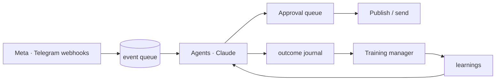

# Agent Ofis — AI Marketing Office

     

A panel where a marketing agency is run by AI "employees". Each client gets a team of agents; a human approves what goes out.

## The team
| Agent | Job |
|---|---|
| Content agents | 2–3 video ideas a day, captions, a virality score, flop analysis |
| Calendar | Content calendar with a scheduled publish job |
| SEO analyst → SEO specialist | Crawls and audits the site with web search, then proposes before/after changes |
| Competitor analyst | Tracks competitors and summarises what works for them |
| Email & SMS | Campaign drafts |
| Training manager | Reads the outcome journal every day and writes *learnings* that are injected into every agent's prompt |

## Platform
- **Channel connections** — Meta OAuth (Facebook pages, Instagram, ad accounts), Meta & Telegram webhooks into an event queue, data-deletion callback, health checks
- **Ads rules** (simulation) to pause losing ads and protect budget
- **Video pipeline** — builds HyperFrames projects from brand templates, adds an AI voice-over, renders MP4
- **Isometric office view** that shows which agent is working on what
- Every agent can run in **simulation mode** without an API key

---

> **Showcase repository.** This repo presents the project — what it does, how it is built and what it looks like.
> The full source code is private. For a walkthrough or a code sample, get in touch.

**Tural Zamanlı** · Data & Automation Developer · [Portfolio](https://dicapso.github.io) · [GitHub](https://github.com/Dicapso)
